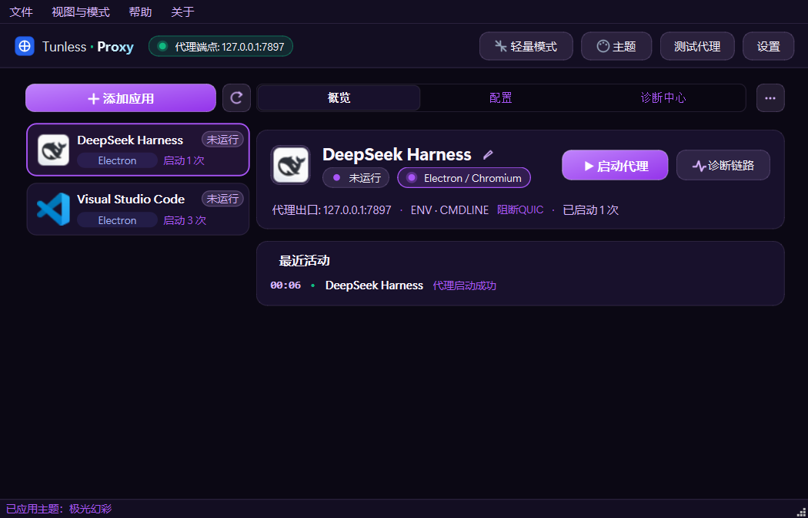
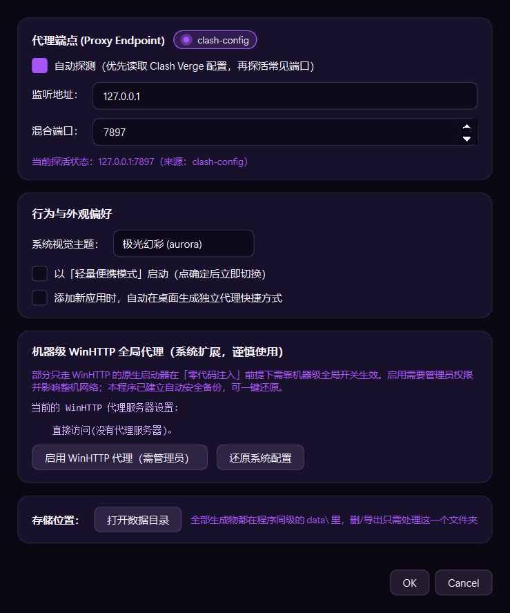
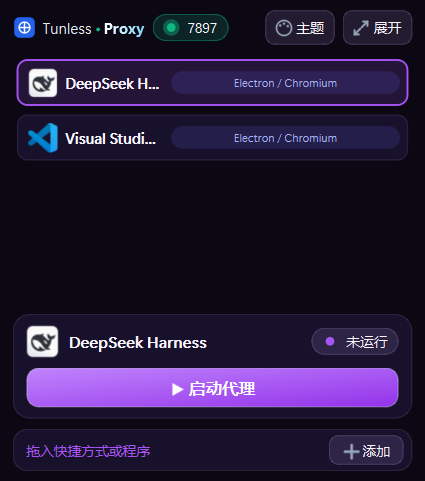
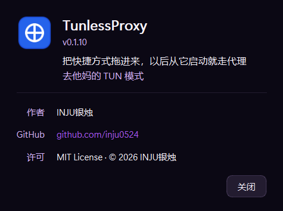

# TunlessProxy 完整手册

**免 TUN、零注入的按应用代理启动器**（Windows）

> 这是**详细手册**：它解决什么问题、五种杠杆怎么工作、数据与配置、开发与判据、
> 已知问题、完整更新记录都在这里。想快速上手请看 [`README.md`](README.md)。

给"用不了 TUN 模式、又不想一个个配代理环境变量"的人用：把快捷方式拖进来，
以后从本程序（或它生成的快捷方式）启动这个应用，它的流量就自动走 Clash。

- **不装 TUN/TAP/WFP 驱动** —— 不需要虚拟网卡，不影响全局路由
- **不向目标进程注入任何代码** —— 不碰目标内存，不 hook API，不需要关闭杀软
- **只在启动时施加手段，作用域限于该进程树** —— 关掉应用就恢复原样



界面是四套主题里默认的「极光幻彩」。切主题有两个入口：顶栏的「主题」按钮，或
「设置 → 系统视觉主题」；深色三套（极光幻彩 / 深空曜石 / 微晶雾面）+ 浅色一套
（超白水晶），选择会记进 `config.json` 的 `settings.theme`。



顶栏的「轻量模式」把它压成一个 340×385 的小启动器（只留软件名、端点状态、
应用列表和一个启动按钮），适合常驻在桌面角落：



设置里那个「机器级 WinHTTP 代理」开关长这样（它显示的是 `netsh winhttp show proxy`
的实时输出 —— 中文系统上 netsh 吐的是 GBK，解码要按代码页来，见「更新记录」）：

---

## 它解决的是什么问题

Clash Verge 的"系统代理"只写 `HKCU\...\Internet Settings`（WinINET）。于是：

| 应用类型 | 为什么不走代理 |
|---|---|
| Electron / Chromium | Windows 上**不读** `HTTP_PROXY` 环境变量 |
| Go / Rust / Node / .NET Core 程序 | 用自己的网络栈，不读 WinINET |
| git / npm / pip / curl / ssh | 各有各的配置文件和开关 |
| 只走 WinHTTP 的原生程序 | WinHTTP 的代理是**机器级**的，系统代理开关管不到它 |

本程序就是逐条堵这些洞。

---

## 快速开始

```powershell
# 依赖本机已装齐（PyQt6 / pywin32 / pefile），没有的话：
pip install -r requirements.txt

# 打开界面
python -m tunless
```

然后把任意快捷方式 / exe **拖进窗口**即可。程序会：

1. 解析 `.lnk` 的目标、参数、工作目录、图标（含链式快捷方式）；
2. 判定应用家族（Electron / WebView2 / Java / Node / 命令行 / 原生）；
3. 按家族自动选择该用哪些代理手段；
4. 需要的话在**桌面**生成一个 `<名称>.lnk` 独立快捷方式，以后从那儿启动就行
   （**默认关闭** —— 往桌面放图标是种打扰，要的话在设置里勾一下，或 `--add` 时加 `--shortcut`）。

点「**用代理启动**」立即启动；下方的诊断面板会实时告诉你
**哪些连接走了代理、哪些在直连**。

---

## 五层手段（都不注入代码）

| 层 | 手段 | 作用域 | 覆盖对象 |
|---|---|---|---|
| **L1** | 环境变量 `HTTP_PROXY` / `HTTPS_PROXY` / `ALL_PROXY` / `NO_PROXY` | 该进程及子进程 | Go、Rust、Python、Node（`NODE_USE_ENV_PROXY=1`）、.NET Core、curl、cargo；JVM 走 `JAVA_TOOL_OPTIONS` |
| **L2** | 命令行 `--proxy-server=` + `--disable-quic` | 该进程（Chromium 系自动传给子进程） | Electron、Chromium、CEF；WebView2 走 `WEBVIEW2_ADDITIONAL_BROWSER_ARGUMENTS` |
| **L3** | 配置文件指针 `GIT_CONFIG_GLOBAL` / `NPM_CONFIG_USERCONFIG` / `PIP_CONFIG_FILE` / `CURL_HOME` / `WGETRC` / `DOCKER_CONFIG` / `GIT_SSH_COMMAND` | 该进程 | git、npm、pip、curl、wget、docker、ssh。**生成在本程序私有目录，不动你的真实配置** |
| **L4** | 快捷方式 | 用户的点击路径 | 让"点原来的图标"也走代理（可一键还原） |
| **L5** | 机器级 `netsh winhttp set proxy` | 全机（需管理员） | 只走 WinHTTP 的原生程序 —— 这是唯一的兜底，会备份原值 |

L3 的私有配置会**把你自己原有的配置 include/合并进来**，所以 token、registry 镜像、
alias 都还在（git 用 `include.path`，npm/pip/curl 用内容合并，docker 用 JSON 合并）。

---

## 能力边界（诚实版）

| 应用类别 | 能否按应用代理 | 靠什么 |
|---|---|---|
| Electron / Chromium（VS Code、Discord、Telegram、Antigravity…） | ✅ | L2 |
| WebView2（新版 Outlook、很多现代 Windows 应用） | ✅ | L2（经环境变量传参） |
| 命令行工具（git / npm / pip / curl / ssh / docker / cargo…） | ✅ | L1 + L3 |
| Java 应用 | ✅ | L1 `JAVA_TOOL_OPTIONS` |
| .NET Framework / WinINET 应用 | ✅（Clash 系统代理已覆盖） | 无需动作，诊断可确认 |
| .NET Core 应用 | ✅ | L1 |
| **只走 WinHTTP 的原生应用** | ❌ 按应用做不到 | 只能用 L5（全机生效） |
| **UWP / 商店应用** | ❌ | 由 `explorer.exe shell:AppsFolder` 启动，施加不了环境 |
| **已经在运行的进程、Windows 服务** | ❌ | 需要注入，本方案明确排除 |
| **游戏（尤其带反作弊）** | ❌ | 需要 TUN 或注入，本方案明确排除 |
| **UDP / QUIC 流量** | ⚠️ 部分 | Chromium 系可加 `--disable-quic` 规避；其他 UDP 代理不了 |

> 为什么 WinHTTP 原生应用做不到按应用？因为 WinHTTP 的代理配置只存在于
> `HKLM\SOFTWARE\Microsoft\Windows\CurrentVersion\Internet Settings\Connections\WinHttpSettings`，
> **没有按进程或按用户的 API**。要按应用拦截就只能注入或上 WFP 驱动 —— 两者都被本方案排除。

---

## 诊断：它到底走没走代理

这是本程序最该被信任的地方。诊断面板直接读系统的 TCP 连接表
（`GetExtendedTcpTable`，无需管理员）拿到**每个 PID 的每条连接**，
再按进程树归集，把每条连接分成：

- **经代理** —— 远端是 `127.0.0.1:7897`
- **直连公网** —— 远端是公网地址（这就是漏网流量，面板会列出来）
- **本地/内网** —— 回环与内网地址，不算漏

再叠加 Clash 自己的连接表（Verge Rev 的控制器开在命名管道上，本程序直接读那个管道）
作为旁证。结论有五种：`已生效` / `部分生效` / `未生效` / `暂无连接`，
以及"进程已退出"（`dead`，启动过的那个 PID 已经不在了）。

命令行也能看：

```powershell
python -m tunless --diagnose <配置ID或ID前缀>
python -m tunless --diagnose <ID> --json
python -m tunless --pid 12345
```

---

## 命令行

```powershell
python -m tunless                       # 打开界面（默认）
python -m tunless --add <路径> [<路径>…]  # 添加应用配置（--shortcut 才在桌面建独立快捷方式）
python -m tunless --add --no-shortcut <路径>
python -m tunless --list                # 列出全部配置
python -m tunless --list --json
python -m tunless --run <ID>            # 用代理启动（生成的快捷方式用的就是这条）
python -m tunless --run <ID> --wait     # 等待结束并透传退出码
python -m tunless --remove <ID>
python -m tunless --shell               # 开一个已经带好代理环境的终端
python -m tunless --test                # 测试代理端点连通性
python -m tunless --doctor              # 环境自检（排障用）
python -m tunless --doctor --json
python -m tunless --repair              # 重新解析全部配置并重建图标/快捷方式
```

`--test` 的判定不是"能不能连上"，而是对比**经代理出口地区**与**直连出口地区**：
两者不同才算代理真的在起作用。

---

## 快捷方式：生成 vs 接管

- **生成**（**默认关闭**，`settings.generateShortcuts`）：在**桌面**建 `<名称>.lnk`，指向
  `pythonw -m tunless --run <ID>`（打包后是 `TunlessProxy.exe --run <ID>`），
  图标用被代理应用自己的图标。桌面目录走 `SpecialFolders("Desktop")`，
  兼容 OneDrive 重定向；应用卡片「···（更多操作）」里的「创建桌面快捷方式」
  做的也是这件事（相当于刷新/补上）—— 那条不受这个开关影响，是你明确点的。
  两条安全规则：
  * **只清理自己生成的**：0.1.8 之前生成在开始菜单里，那两份会被顺手清掉 ——
    但删除前会解析 `.lnk`，确认"目标指向本程序 + 参数里有 `--run`"才动手；
    你自己放在那儿的同名快捷方式、以及被「接管」的那一个，绝不会碰。
  * **不覆盖别人的同名图标**：桌面上已经有一个不是本程序生成的 `<名称>.lnk` 时，
    宁可拒绝并说明，也不覆盖 —— 要接手它请用「接管原快捷方式」（会先备份原文件）。
- **接管**（默认关闭，入口是应用卡片「···（更多操作）」里的「接管原快捷方式」）：
  把**原快捷方式原地替换**成指向本程序。这样开始菜单和任务栏固定项都会走代理。
  原文件会先备份到 `data\backup\lnk\`，界面上有「还原」按钮，
  退出时也会询问是否还原。

---

## 数据与配置

**所有生成物都在程序同级的一个 `data\` 里**，删干净或整体导出只需要处理这一个文件夹：

```
<TunlessProxy.exe 所在目录>\data\config.json          全部配置
                            \data\icons\<id>.png/.ico  提取的图标
                            \data\profiles\<id>\       L3 生成的私有配置
                                gitconfig  npmrc  pip.ini  .curlrc  wgetrc  ssh_config  docker\config.json
                            \data\backup\lnk\          被接管快捷方式的原始备份
                            \data\logs\                启动日志、launches.jsonl、crash.log
```

源码运行时"程序目录"就是项目根（`tunless/` 的上一层），所以是 `<项目根>\data\`。
唯一不在这里的是**桌面上的那几份快捷方式** —— 它们必须落在桌面（或你原来的位置）才有意义。

两个例外，都会在 `--doctor` 与「设置 → 存储位置」里如实说明：

- **程序装在不可写的位置**（`C:\Program Files\...`、只读盘）：自动退回
  `%APPDATA%\TunlessProxy`，否则程序会因为写不了配置直接起不来。想放程序旁边，
  把程序移到可写目录即可。
- `TUNLESS_DATA_DIR` 环境变量可以强制指定数据目录（验收脚本与"一份程序多份数据"
  用得上，正常使用不会碰）。`--doctor` 里的 `dataDirSource` 会告诉你是哪种：
  `portable` / `appdata` / `env`。

从旧版本升级时会**自动把 `%APPDATA%\TunlessProxy` 与 `%LOCALAPPDATA%\...\logs`
里的数据复制到 `data\`**（复制不是移动，确认无误后旧目录可以自己删掉），
`--doctor` 的 `migration` 字段会显示搬了什么。

每次启动都会写一份 `launch-*.log`，里面记录实际用的层、注入的每个环境变量、
生成的配置文件、PID 与退出码 —— 出问题先看这个（在 `data\logs\`）。

代理端点默认自动探测：先读 Clash Verge 的 `clash-verge.yaml`（mihomo 实际在跑的
合并后配置，`mixed-port` 以它为准；`config.yaml` 只是模板，作为兜底），
再读注册表里的系统代理，最后探活 `7897/7898/7899/1080/10808/7890/2080`。
也可以在「设置」里手动指定。

### 顶部软件名

顶栏的软件名是**静态**的三段式字标（`tunless/gui/title_mark.py`），刻意做到极简：

```
Tunless     ●      Proxy
细体300    3px     粗体700 + 横向渐变
#E2E8F0  #10B981   #FFFFFF → #7DD3FC
```

- 一个 `QHBoxLayout`（`spacing=4`，垂直居中）+ 两个标签 + 一个圆点，
  没有画布、没有定时器、没有字形路径 —— 尺寸完全由字体度量决定，所以天然与左侧图标、
  右侧端点胶囊保持基线居中。
- **`Proxy` 是横向渐变**（左端近纯白 → 右端冰蓝），这是照着参考图量出来的：同一笔的
  上下颜色一致、整词从左到右由白转蓝。QSS 没有"把渐变剪进文字"的能力
  （`background-clip: text` 是 Web 的东西），所以这一段重写了 `paintEvent`，
  用 `QPen(QBrush(渐变))` 直接画字。
- **点的直径与两侧间距也是量出来的**：参考图里 点直径/大写高 ≈ 0.25、间距/大写高 ≈ 0.31。
  按 14px 字号（Segoe UI Variable 的大写高约 10px）换算就是 2.5px 与 3px，
  实现取 3px 点 + 4px 间距（再小在高 DPI 下会糊）。圆点自己 `drawEllipse` 画，
  不用 QSS `border-radius` —— 3px 见方配 1px 圆角出来是圆角方块，像个小十字。
- 背景**完全透明**、无描边、无发光。绿色微点（`#10B981`）与右侧「运行状态」胶囊同色，
  是这枚字标唯一与状态呼应的元素。
- 颜色随主题走：深色主题用上面那三个颜色；浅色主题（超白水晶）换成同设计的深色版
  （`#334155` / 同一个绿点 / `#0F172A → #0284C7`）—— `#E2E8F0` 放在白底上对比度
  不到 1.1:1，照抄颜色等于把这半截字藏起来。

> 0.1.6 之前这里是一枚多层合成的动态 Logo（渐变色环 + 流光 + 彩色外发光，
> 可在设置里调六个参数）。它已被整体移除，`data\config.json` 里的 `brandMotion` 不再有作用。

把主题与轻量模式写进配置（重启后生效；界面里改会立刻生效并自动写回）：

```jsonc
{
  "settings": {
    "theme": "frosted",              // aurora | midnight | pure-crystal | frosted
    "compactMode": true,             // 下次启动直接用轻量便携模式
    "generateShortcuts": false       // 添加新应用时是否在桌面建独立快捷方式（默认 false）
  }
}
```

---

## 开发

```powershell
python tests\run_all.py            # 全部测试（标准库 unittest，不需要 pytest）—— 49 项
python tests\check_layout.py       # 布局 + 顶部软件名（三段构成/字重/配色/位置/顶栏适配）—— 31 项
python tests\check_gui_robustness.py  # GUI 健壮性：槽异常不许 abort、按钮点击不许报错 —— 8 项
python tests\gui_smoke.py          # 把界面渲染成 PNG，用来确认布局没崩
python tests\gui_smoke.py out.png
python tests\capture_docs.py       # 用真实字体重新生成 docs/ 里的四张 README 截图
python tests\verify_package.py     # 打包产物验收（对着 dist 里的 exe 跑真实链路）
```

`run_all.py` 只发现 `test_*.py`，也就是 `tests/e2e/test_matrix.py`；GUI 相关的几项
（`check_layout` / `check_gui_robustness` / `gui_smoke` / `capture_docs`）要单独跑。
它们都会驱动真实窗口，因此都把 `config.save` 换成了桩 —— 否则跑一次自检就会把
用户的主题偏好改掉（`check_layout.py` 会连着切四套主题，最后一个会留在配置里）。

`check_gui_robustness.py` 的判据跑在子进程里：要复现的失败模式（PyQt6 槽里未捕获
异常）会让进程以 `0xC0000409` 直接中止，同进程里测会连测试自己一起带走。

`check_layout.py` 里字标那几条判据是"按规格"验的：三段文字内容、微点尺寸、
背景是否透明、细体/粗体两个字重是否真的不同、深色与浅色两套配色是否正确、
以及字标高度不超过顶栏。这些**不是**"看起来差不多"，改错一个字重或颜色就会红。

测试的判据刻意**不依赖外网**：`tests/e2e/tiny_proxy.py` 是一个会记录请求的假代理，
断言"请求到底有没有到达代理"。这比拿 ip-api 对比出口 IP 可靠得多 ——
后者会被 Clash 的系统代理干扰（Chromium 会读 WinINET，直连测试也会走代理，
根本证明不了什么）。其中还包括一条 `--no-proxy-server` 的对照组。

---

## 打包

```powershell
python -m PyInstaller --noconfirm --clean tunless.spec
python tests\verify_package.py     # 22 项验收
```

验收里的两条值得单独说：

- **「dist 由当前源码构建」**：把 exe 内嵌 PYZ 里每个 `tunless.*` 模块的字节码与当前
  源码逐字段比对（`co_code` / `co_names` / 局部变量 / 常量 / 嵌套函数递归）。
  比"看 exe 时间戳比 .py 新"可靠 —— 时间戳会被 touch、复制、校验修改骗过。
  比对时要 `compile(..., dont_inherit=True)`，否则本模块自己的
  `from __future__ import annotations` 会继承给源码侧、凭空报出假差异。
- **「打包版顶部软件名是三段式」**：`PrintWindow` 抓打包程序**真实窗口**的像素，
  在软件名那一段里分类统计：绿色微点（`#10B981` 同族）、偏蓝的 "Proxy"、
  低饱和但有亮度差的 "Tunless"，另外要求**紫色像素为 0**（原来那套紫色发光字标
  必须彻底不在了）。这条需要可见桌面，也会短暂弹出一次窗口；
  已有实例在跑（单实例）或没有桌面时会显式跳过并说明原因。
  抓图前必须 `SetProcessDpiAwarenessContext` —— 否则 125% 缩放下的进程拿到的是
  虚拟化坐标，`PrintWindow` 会按缩小后的矩形去画真实窗口，右边被裁掉，
  看上去像"界面被切了"，其实只是截图工具的问题。

产物在 `dist/TunlessProxy/`（约 63 MB，143 个文件），**两个 exe**：

| 文件 | 用途 |
|---|---|
| `TunlessProxy.exe` | **窗口化**（`console=False`）。双击开界面；`--run <id>` 静默启动应用。快捷方式指向的就是它，所以双击不会闪黑框。 |
| `tunless.exe` | **控制台版**。给命令行用，`--list` / `--doctor` / `--test` 的输出看得见。 |

两者共用同一份 `_internal`，所以只比单 exe 多几百 KB。
`shortcuts.launcher_command()` 在 frozen 模式下**总是优先选窗口化那个 exe**，
即使用户是从 `tunless.exe --add` 添加的应用也不会闪黑框。

几个刻意的取舍：

- **onedir 而不是 onefile**：本程序是常驻托盘的工具，onefile 每次启动都要解压到临时目录，
  既慢又更容易被杀软误报。
- **不开 UPX**：UPX 会显著提高杀软误报率。
- **裁掉用不到的二进制**：`opengl32sw.dll`（Qt 的软件 OpenGL 回退，20 MB，纯 Widgets 程序用不上）、
  `Qt6Pdf.dll`、pywin32 的 `Pythonwin` IDE（6 MB），以及 imageformats 里除 `qico`/`qpng`
  之外的插件。这一刀把体积从 96 MB 压到 63 MB。
- **入口脚本是根目录的 `tunless_entry.py`**，不是 `tunless/__main__.py` ——
  后者用相对导入（`from .cli import main`），被 PyInstaller 当顶层脚本执行时会 ImportError。
- `console=False` 时 `sys.stdout` 是 `None`，`print()` 会炸；`tunless/__main__.py`
  里的 `_NullWriter` 兜住了这一点，错误信息另外落到 `logs/run-errors.log`。

打包后实测确认过的一个关键点：**窗口化的父进程用 `CREATE_NEW_CONSOLE`
拉起命令行子进程时，子进程能拿到有效的控制台句柄**（`tests/probe_stdout.py` 验证
`isatty=True`、写入正常），所以 `--shell` 和命令行类应用的新窗口里看得到输出。

---

## 设计取舍

**为什么不做 DLL 注入？** 注入（Proxifier / proxychains 那条路）确实能覆盖
"死不走代理"的应用，但它需要编译原生 hook DLL、处理 32/64 位与反作弊冲突、
并且会被 EDR 盯上。既然目标是"给用不了 TUN 的人一个够用的方案"，
先用零注入手段把 90% 的场景覆盖掉更划算。真需要注入时，
`winget install MartinStorsjo.LLVM-MinGW.UCRT` 就能补上工具链。

**为什么不做 TUN？** 需求本身就是这么定义的（用不了 TUN 的人）。

**被否决的备选方案**：
- 临时改 `HKCU` 的 WinINET 全局代理再定时还原 —— 有竞态、影响全局，而且
  Clash 的系统代理本来就开着，收益为零；
- 换一个专用 Windows 用户跑应用 —— WinHTTP 配置在 `HKLM`，换用户解决不了盲区；
- 只设环境变量 —— 覆盖不了 Electron，而 Electron 恰是主要目标。

**其它刻意的选择**：
- 用 `subprocess.Popen(命令行字符串)` 而不是列表：Windows 上字符串会被原样
  作为 `lpCommandLine` 传给 `CreateProcess`，用户原有的引号/反斜杠不会被破坏；
- 自己写 `split_windows_args` 而不是用 `shlex`：`shlex.split(posix=True)`
  会把 `C:\Program Files\x` 里的反斜杠当转义符吃掉；
- 只在命令行里追加参数、不改用户参数：Chromium 取最后一个同名开关，追加在后面正好生效；
- `%VAR%` 会被展开（`CreateProcess` 自己不展开，那是 `cmd.exe` 干的），
  但只展开 `%VAR%`，不碰 `$VAR`。

---

## 已知问题

- 某些 Electron 应用会忽略甚至覆盖 `--proxy-server`（应用内自带的代理设置优先）。
  这种情况下诊断面板会立刻显示直连，README 建议在该应用设置里选"使用系统代理"
  或手动填 `127.0.0.1:7897`。
- `JAVA_TOOL_OPTIONS` 会让 JVM 往 stderr 打一行 `Picked up JAVA_TOOL_OPTIONS:`，属预期噪声。
- 为命令行工具生成的 `ssh_config` 顶层带一条全局 `ProxyCommand`（并 `Include` 了你自己的
  `~/.ssh/config`），所以它拉起的 ssh 都会走代理。**它依赖 Git 自带的 `connect.exe`**，
  没装 Git 的机器上这条会静默失效（现在启动时会出一条提示说明）。不想要就关掉该应用的 L3。
- 需要管理员权限的目标程序：请**以管理员身份运行本程序**，否则代理设置传不进去
  （UAC 提权会经 AppInfo 服务，环境就断了）。
- `--repair` 会重建桌面上的快捷方式；如果你手动改过快捷方式的名字，改完再跑一次即可。
- **主题还留着一批硬编码颜色**：列表里的家族徽标（Electron 靛蓝 / WebView2 天蓝 /
  命令行绿）、顶栏两个按钮的图标灰、诊断表格的 `yellow`/`lightGray` 都绕过了主题令牌。
  深色三套主题下没问题，浅色的「超白水晶」下这几个地方对比度偏低。
- **诊断面板的轮询还在 GUI 线程**：每 2 秒同步做一次进程快照 + 全量 TCP 表 + Clash 查询，
  并读 mihomo 的命名管道（`ClashApi._http_get_pipe` 声明的超时参数其实没用上）。
  管道卡住时界面会跟着卡；窗口收进托盘或切轻量模式后定时器也不停。
- 轻量模式把状态栏和菜单栏一起藏了，状态提示现在退化成底部那行文字（8 秒后换回拖拽提示）。
- 托盘菜单只有「打开主窗口 / 代理终端 / 测试连通性 / 退出」和最近应用列表，没有模式与主题项；
  重命名应用后托盘里的旧名字要等下一次 reload 才刷新。
- `config.json` 是多进程共写的（GUI 一份、快捷方式拉起的 `--run` 一份），最坏情况是
  "后写的赢"：GUI 整份重写时可能把另一进程刚更新的启动次数盖回去。临时文件名已带 pid，
  并发写不再抛异常，但丢更新这件事没根治。
- 同名应用的快捷方式会互相占用（`System32\notepad.exe` 与 `SysWOW64\notepad.exe`
  会映射到同一个 `notepad.lnk`）。搬到桌面之后这条更值得注意：第二个重名应用会直接
  被拒绝（`ShortcutOccupied`，不会覆盖已有的那个）。
- **重建 `dist` 会连 `dist\TunlessProxy\data\` 一起删掉**（PyInstaller 的 COLLECT 会
  先 `rmtree` 整个输出目录）。打包版按"配置放在程序旁边"设计，那份数据是它自己攒的；
  如果你在用打包版，重建前先把 `data\` 挪出来。源码运行（`data\` 在项目根）不受影响。
- `--diagnose <ID>` 取的是最近一次启动记录的 PID，而进程表只看 PID 是否存在 ——
  PID 被系统复用后可能诊断到无关进程。
- 小量历史遗留：`theme_tokens.py` 里还有一批没人读的旧令牌全局量；QSS 里的
  `QListWidget#ProfileList::item` 规则是死规则（列表由自绘委托接管）；
  `Profile.adopt_shortcut` 这个布尔字段没人写也没人读（接管状态实际看 `adopted_shortcut`）。

---

## 更新记录

### 0.1.10

- **新增「关于」页**：菜单栏 `帮助` 的右边多一个「关于」项，点一下弹出——
  应用图标 + 名称 + 版本号 + 两句定位 + 作者 / GitHub / 许可。
  配色跟当前主题走（4 套主题都验过），GitHub 那行可点击、用默认浏览器打开。
  版本号从 `tunless.__version__` 读，不会写着旧版本。
- **补齐作者与许可**：新增 `LICENSE`（MIT，`Copyright (c) 2026 INJU银烛`），
  README 末尾加「作者与许可」一节。署名/链接/许可/版权年份只写在
  `tunless/__init__.py` 里一份（`__author__ / __url__ / __license__ / __copyright__`），
  关于页、README 与测试共用它。
- 分工说明：「帮助 → 能力边界说明」讲"能做什么、不能做什么"，
  「关于」只回答"这是什么、谁写的、什么许可"，两者不合并。

### 0.1.9

- **「添加新应用时自动生成独立快捷方式」改成默认关闭**（`settings.generateShortcuts`
  默认 `false`）。桌面是用户自己的地盘，默认往上面放图标是种打扰；要的话在设置里勾一次，
  或者 `--add` 时加 `--shortcut` 只建这一次（一次性开关不写回设置）。
  顺带把命令行补齐成对称的两个开关：`--shortcut` / `--no-shortcut`，
  都不给才跟随设置（之前 `--add` 是无条件建，等于命令行绕过了这个开关）。
  应用卡片菜单里的「创建桌面快捷方式」不受影响 —— 那是你明确点的动作。
  旧键 `generateStartMenuShortcuts` 仍然读得到，不会把你原来的选择改掉。

### 0.1.8

- **自动生成的独立快捷方式从开始菜单改到桌面**（`settings.generateShortcuts`，
  旧键 `generateStartMenuShortcuts` 仍然读得到，不会把你"关掉自动生成"的选择改回来）。
  搬家的同时补了两条安全规则，因为桌面是用户自己的地盘：
  * 旧版本留在开始菜单里的那两份会被清理，但删之前会解析 `.lnk` 确认
    "目标指向本程序 + 参数里有 `--run`"——你自己放在那儿的同名快捷方式、
    以及被「接管」的那一个绝不会碰；
  * 桌面上已有**别人的**同名图标时抛 `ShortcutOccupied`，拒绝覆盖并说明怎么办
    （用「接管原快捷方式」会先备份原文件）。原来在开始菜单里我们有自己的子目录，
    不会撞名；桌面没有这层隔离。
- **顶部软件名的绿点下移**：参考图实测"点中心 = 大写顶 + 0.570 × 大写高"，
  而直接丢进布局垂直居中的结果是 0.461（居中的是行框、不是大写高），看着就是偏高。
  现在 `Dot.align_to(font)` 按字体度量算位置，实测 0.578。
- 判据：`check_layout` 增加"点落在大写高 57% 处（±0.02）"；打包验收里
  "开始菜单快捷方式"那条改成"生成位置就是桌面"，并在桌面上已有同名文件时显式跳过，
  免得覆盖你自己的图标。
- 顺手修掉两处相关的坑：`delete_profile` 会先把被接管的图标还原成你自己的，
  之后清理时**绕开**那个文件（它可能就躺在生成位置上，刚还原完又被删掉）；
  `ensure_dirs` 不再预建开始菜单目录（否则开始菜单里会一直留着一个用不到的空文件夹）。

### 0.1.7

- **字标按参考图做了二次校正**（0.1.6 的字面参数与参考图对不上）：
  - `Proxy` 改成**横向渐变**（左端 `#FFFFFF` → 右端 `#7DD3FC`）。参考图实测：
    同一笔上下颜色一致（不是纵向渐变），整词从左到右由白转蓝（最右端峰值 ≈ `#A1C7FA`）。
    QSS 没法把渐变剪进文字，这一段重写了 `paintEvent` 用渐变刷子画字。
  - **点直径与间距按量出的比例缩紧**：参考图 点/大写高 ≈ 0.25、间距/大写高 ≈ 0.31，
    原来的 4px 点 + 6px 间距相当于 0.40/0.61（点偏大、间距偏松）。
    现在 3px 点 + 4px 间距，圆点改为 `drawEllipse` 自绘（3px 配 QSS 圆角会变成圆角方块）。
  - 判据同步：布局检查加"Proxy 是白→冰蓝横向渐变""渐变端点真的传到了控件上"；
    打包验收加"Proxy 左端与右端明显不同色"，并把三段顺序改成按**极值**判定
    （渐变的左端接近纯白，会被算进"中性字"，用中位数比会误判）。

### 0.1.6

- **顶部软件名换成极简三段式字标**：`Tunless ● Proxy` —— 细体 300 的中性灰白 +
  4×4 绿色微点（与右侧运行状态胶囊同一个绿）+ 粗体冰蓝。背景完全透明、无描边、
  无发光、无动画。见 [`tunless/gui/title_mark.py`](tunless/gui/title_mark.py)：
  一个 `QHBoxLayout`（`spacing=6`）+ 两个 `QLabel` + 一个圆点，尺寸由字体度量决定，
  因此天然与左侧图标、右侧端点胶囊基线居中。
  浅色主题（超白水晶）自动换成同设计的深色版（`#334155` / 同一个绿点 / `#0369A1`）——
  `#E2E8F0` 在白底上对比度不到 1.1:1，照抄颜色等于把这半截字藏起来。
- **整套动效字标子系统被移除**：`tunless/gui/brand.py`（多层渐变 + 流光 + 彩色外发光
  的绘制引擎）、设置里的「品牌字标动效」卡片（六个滑杆 + 实时预览 + 取消回滚）、
  `config.json` 的 `brandMotion`、`tests/check_brand.py`（51 项像素级回归）、
  `tests/brand_preview.py`，以及主题令牌里的 `brand_wordmark` 色环。
  **顶栏高度也从 54px 回到 46px** —— 那条加高是为了给光晕留白，静态字标不需要。
- 判据同步改造：`check_layout.py` 新增 6 条"按规格"的判据（三段文字内容、微点 4×4、
  背景透明、细/粗两个字重真的是 300 与 700、深浅两套配色、字标不撑高顶栏）；
  打包验收里原本"字标是彩色的 / 字标在动"两条，换成"顶部软件名是三段式
  （绿点 + 偏蓝文字 + 中性文字）"与"**紫色像素为 0**（旧样式彻底不在）"。
- `check_gui_robustness.py` 里原来用 `brandMotion` 验的"设置对话框不许丢掉界面不认识
  的键"，改成塞一个中性的哨兵键（`futureKnob` / `futureScalar`）—— 判据不变，不再依赖
  已删除的功能。

### 0.1.5

- **生成物集中到程序同级的一个 `data\`**：以前配置在 `%APPDATA%\TunlessProxy`、
  日志在 `%LOCALAPPDATA%\TunlessProxy\logs`，用户想删干净或整体导出得跑两个地方。
  现在全在 `<exe 所在目录>\data\`（源码模式是 `<项目根>\data\`），一个文件夹可删可拷。
  升级时会自动把旧位置的数据**复制**过来（不移动，确认无误后旧目录可自行删除），
  `--doctor` 会显示 `dataDir` / `dataDirSource` / `migration` 三个字段。
  程序装在不可写位置（Program Files）时退回 `%APPDATA%` 并在设置里说明。
- **去掉 0.1.4 加的配置快照备份**：用户不需要，改成一个 `data\` 就够了。
  保留 `save()` 里"补上 version / profiles 两个键"的兜底（那不是备份，
  是防止某一处漏写就产生残配置）。
- 验收脚本与单元测试改跑在临时数据目录（`TUNLESS_DATA_DIR`）：打包版默认用
  `dist\TunlessProxy\data\`、脚本默认用 `项目根\data\`，不统一的话两边不是同一份数据；
  顺带保证跑测试/验收不会动用户真实的应用配置与日志。
- 设置里的「存储位置」改成单一入口「打开数据目录」+ 一行说明（原来列的是已经
  不存在的旧路径）。

### 0.1.4

按实际使用反馈修的三件事：

- **修掉 0.1.3 引入的按钮回归**。`@guarded` 包装器用 `functools.wraps` + `*args`，
  PyQt 因此认为它接受任意参数，于是 `QPushButton.clicked(bool)` / `QAction.triggered(bool)`
  自带的那个 `False` 被原样转发给了 `open_settings()` 这类不收参数的槽 ——
  点「设置」「重新解析」「打开代理终端」都会弹一个"操作未完成：
  TypeError: takes 1 positional argument but 2 were given"。现在包装器按原槽签名裁掉
  多余参数，并补了两条判据：单元级的 `guarded-arity`，以及端到端模拟点按钮/菜单项、
  断言不出现任何错误框。**这个回归能溜进 0.1.3，是因为上一轮的判据只测了"槽里抛异常
  不会 abort"，没测"正常点一下也不该报错"。**
- **「创建桌面快捷方式」真的写到桌面上**。菜单项的文案一直是"桌面"，代码却写进开始菜单
  （`create_shortcut` → 开始菜单目录），用户点完在桌面上什么也看不到。现在走
  `create_desktop_shortcut()`，桌面目录**问 Shell 要**（`SpecialFolders("Desktop")`）——
  开了 OneDrive 的机器上桌面被重定向到 `OneDrive\桌面`，拼 `%USERPROFILE%\Desktop`
  同样会"看不见"；写失败会明确报错而不是静默。开始菜单那份仍在添加应用时生成。
- **字标观感按反馈调整**（该动效字标已在 0.1.6 整体移除，此处仅作记录）：
  外发光扩散加大、色环间距收紧；同时修正了一条量错对象的判据 ——
  「浅色主题下字标依然清晰可读」原来把外圈光晕也当字形，改成只看字形内部。
- **给"应用列表被写没"这类事故加了兜底**：`config.save` 会补上 `version` 与
  `profiles` 两个键，避免某一处漏写就产生一份"没有 version、没有 profiles"的
  残配置 —— 排查期间真的见过这种文件，后续所有判断都会跟着乱套。

### 0.1.3

这一版是**一次完整审查后的修复版**：把界面重做（0.1.2 起）以来积累的一批"平时看不出、
出事就难看"的问题逐条钉住，每条都配了回归判据。

**数据与进程安全**（这几条都属于"一旦触发就是事故"）：

- **配置读失败不再清空用户数据**。`config.load()` 遇到损坏的 `config.json` 会返回一份
  `profiles` 为空的默认配置，而启动时的"清理无主数据"照删就会把 `profiles/<id>/`
  与图标全部删掉 —— 那是销毁数据，不是清理。现在 `_loadError` 一旦存在就跳过清理。
- **配置里一个应用都没有时也不清盘**（新增 `prune_profile_dirs(force=)`）：正常用户不会
  "一个应用都没有、磁盘上却堆着一堆目录和图标"，这种组合更像配置被写坏了。真要清就走
  `--repair`（force=True），那是用户明确要求的动作。
- **接管快捷方式后 `--repair` / 「重新解析」不会再造成无限自我拉起**。接管是把原 `.lnk`
  原地改成指向本程序（`--run <id>`），再拿它当"应用自身"解析出来的目标就是启动器自己，
  保存后启动 = 用同一个 id 再拉起启动器，子进程读同一份配置继续拉起。现在
  `refresh_profile` 对被接管的配置直接返回，`proc.launch` 还有一道"目标就是本程序"的兜底拒绝。
- **启动日志不再泄凭据**。脱敏关键字从 8 个扩到覆盖 `PASS/PWD/SECRET/TOKEN/KEY/SESSION/
  COOKIE/CREDENTIAL/BEARER/AUTH`，并且**命令行本身**也做同样的键名脱敏（`--api-key=…`、
  `--token "…"`），`launches.jsonl` 一并处理。
- **用户参数引号没闭合时会明说**。`--foo "C:\dir\` 这种以反斜杠+引号结尾的路径会让后面
  追加的 `--proxy-server` 被并进同一个参数 —— Chromium 收不到开关，界面上却一切正常。
  现在拼完命令行会反查一次，吞掉就把"代理开关可能未生效"写进启动提示。
- **并发保存不再抛异常**：`config.json` 的临时文件名带上 pid（GUI 与 `--run` 是两个进程
  共写同一份配置，原来共用 `.json.tmp`，后写的那个 `os.replace` 会撞上已被替换的文件）。

**GUI 稳定性**：

- **槽里抛异常不再把整个程序带走**。PyQt6 里由 C++ 触发的槽若抛出未捕获异常会直接
  `qFatal`（进程以 `0xC0000409` 中止），`sys.excepthook` 拦不住。所有会落盘 / 解析 /
  建快捷方式的槽现在都有兜底：弹一句"这一步失败了，其他功能不受影响"，其余状态不变。
- **设置对话框不再泄漏**：它 parent 是主窗口，之前"关掉"只是隐藏，C++ 对象一直挂着
  （连开几次就多几份整棵控件树）。现在读完值显式回收。
  这里刻意**不用** `WA_DeleteOnClose`：它会在嵌套 `exec()` 返回时就销毁对话框，
  而我们还要读它的控件值（`apply_to_config` 会摸 `compact_box`）——
  第一版就是这么写的，被 `@guarded` 兜住才暴露出 `wrapped C/C++ object has been deleted`。
- 主题信号全部改成绑定方法连接（原来是 `lambda _: self.update()`，捕获 self 等于给每个
  主题化控件上了"永生"引用，这也是对话框回收不掉的根因）。
- **没有托盘图标时关窗会真正退出**（explorer 崩了 / Server Core / 某些会话）：之前是
  "关窗=隐藏"，窗口没了、托盘也没有，程序还在跑且只能去任务管理器杀。
- 拖入 `.txt` 之类的文件不再亮起"✨ 放手即可立即添加！"（只对真正支持的类型亮）。
- 浅色主题下切主题后，"最近活动"两行的颜色会跟着刷新（时间色与状态点在渲染时就固化了）。

**其它**：

- 「轻量便携模式」在设置里勾上/取消后立刻生效（之前要重启才对上）。
- 端点胶囊不再恒为绿色"通"：`"通" if endpoint else "?"` 里的 endpoint 是 dataclass、
  永远为真值，所以那个分支是死的。现在真做一次端口探活，不通就显示"（不通）"并转告警色。
- 诊断面板改用与启动逻辑同一份 Clash 配置（之前 GUI 恒用自动探测，手改 `clashConfigPath`
  后两边证据对不上）。
- WinHTTP 还原改回"按备份里的原地址还原"：之前是拿**界面上的** host:port 重新 set，
  等于把机器原本的企业代理改成 `127.0.0.1:7897` 还对外宣称"已还原"；解析不出原值就明确
  报错，不去猜、也不动系统设置。
- 关掉 L3 之后不再被追加 `-F <私有 ssh 配置>`（磁盘上那份 `ssh_config` 是上次留下的，
  只看 `is_file()` 会继续生效）。
- 删除废弃的 `tunless/gui/theme.qss`（样式早已改为 `theme_tokens.generate_qss()` 动态生成，
  它没有任何读取路径），同步去掉打包配置里的 `datas` 与验收里"已打进包"那条断言。
- 主题默认值收敛到 `theme_tokens.DEFAULT_THEME_ID` 一份（原来在 5 处硬编码），
  `DEFAULT_SETTINGS` 补上 `theme` / `compactMode`。
- 新增 `tests/check_gui_robustness.py`（5 项，判据跑在子进程里）、
  `tests/capture_docs.py`（用真实字体重生成 README 截图），`tests/e2e` 增加
  8 项安全回归（配置损坏不清盘、接管不被重解析、拒绝自我拉起、脱敏、引号提示、
  ssh 跟随 L3、WinHTTP 还原、并发保存）。验收脚本新增"dist 是否由当前源码构建"
  与"打包版标题渲染"两条。

### 0.1.2

**界面重做成深色控制中心**：顶部品牌条 + 左侧应用列表 + 右侧「概览 / 配置 / 诊断中心」
三段切换，应用卡片显示家族与运行状态，危险操作收进「更多操作」。

- **4 套主题**（`tunless/gui/theme_tokens.py`）：极光幻彩（默认）、深空曜石、
  超白水晶（浅色）、微晶雾面。顶栏「主题」按钮、菜单「视图与模式 → 切换主题」、
  设置里的「系统视觉主题」三个入口，改动即时生效并记进 `settings.theme`。
  样式不再读静态 `theme.qss`，改为按当前主题生成 QSS + 组件订阅 `themeChanged`。
- **轻量便携模式**：340×385 的小启动器，只留软件名、端点状态、应用列表与启动按钮。
  顶栏按钮 / 菜单 / 设置里的复选框都能切，记进 `settings.compactMode`。
- **顶部字标**当时做成了多层合成的动态 Logo（渐变色环 + 流光 + 彩色外发光，
  设置里可调六项，另有 `tests/check_brand.py` 做像素级回归）——
  **这部分已在 0.1.6 整体移除**，改成极简的三段式静态字标，此处仅作记录。

顺带修掉的：

- **设置对话框在 768p 屏上按钮跑出屏幕**。加了品牌动效卡片后内容高到 785px，
  可用高度只有 700 出头。现在卡片排成两列，整体放进滚动区，并按可用屏幕高度
  决定初始尺寸。
- **「取消」不会回滚字标实时预览**。预览是立即生效的，之前点取消会留下一套
  没保存的参数，下次启动又变回去。现在 `reject()` 会推回打开前的参数。

### 0.1.1

修掉一批实际使用中暴露的问题：

- **设置里 netsh 输出乱码**。打包后的 GUI 没有控制台，`netsh` 按系统代码页（中文是 936）
  输出 GBK，之前一律按 UTF-8 解码，界面上就是一片「����」。改成
  "UTF-8 → OEM 代码页 → 本地 ANSI → latin-1" 依次尝试。
- **图标缓存一直是空的**。大量真实 `.lnk` 的 `IconLocation` 就是字面量 `,0`
  （Windows 约定：路径为空 = 用目标程序自己的图标），之前把它当成文件路径，
  导致图标提取全部失败、生成的快捷方式图标也是坏的。现在会归一化成
  `<目标 exe>,0`；`--repair` 可以修复已有配置。
- **`PYTHONUTF8=1` 被泄漏给用户的应用**。入口脚本曾经设置这个环境变量，
  而本进程环境会被 `CreateProcess` 原样传给每个被启动的应用，等于偷偷把别人
  拉进 UTF-8 模式。现在只调整自己的输出流，不动环境。
- **`bind-address: '*'` 被当成主机名**。Clash 开 `allow-lan` 时端点会变成
  `*:7897`（连不上）。现在会归一化回落到 `127.0.0.1`。
- **手动指定端口不生效**。设置对话框写的是 `{"host":..,"port":..}`，
  而 `ProxyEndpoint.from_dict` 只认 `mixedPort`，端口被静默忽略。
- **「测试代理」会卡住界面**。最坏要串行试 4 个回显端点再乘两条路径，
  能卡好几秒。已挪到 `QThread`。
- **「重新解析」会冲掉用户手填的启动参数**。现在目标路径没变时保留 args/workdir。
- **编辑详情面板会整块重置**。每次保存都重建列表 → `setCurrentRow` → 触发选中变化 →
  重置详情面板。改成就地更新条目。
- **退出时"是否还原已接管的快捷方式"可能被静默跳过**。之前复用了
  "托盘气泡已提示过"这个标志当条件。
- **孤儿数据不再堆积**。`profiles/<id>/` 和图标是 `build_plan` 顺手创建的，
  profile 没被保存时就会永远留着（实测积了 78 个）。启动时自动清理，另加 `--repair`。
- **启动日志不再明文记 token**。环境变量里常带 API key，现在按关键字脱敏。
- 其它：`--no-shortcut` 不再把设置持久化；`--list 某路径` 不再被误当成 `--add`；
  `QSpinBox` 的上下箭头不再被样式挤掉；manifest 支持 UTF-16；代理端点加 2 秒缓存。

---

## 作者与许可



- **作者**：INJU银烛
- **GitHub**：<https://github.com/inju0524>
- **许可**：[MIT](LICENSE) —— 可自由使用、修改、分发（包括商用），保留版权声明即可。
- **版权**：© 2026 INJU银烛

程序内「关于」（菜单栏 `帮助` 右边那一项）显示的就是上面这几行；
版本号、署名、链接、许可都只在 `tunless/__init__.py` 里写一份，
页面、README 与 `--version` 读的是同一个来源，不会有"某处还写着旧版本"的情况。

> 顺便说清楚边界：这是一个**按应用**施加代理的启动器，不装 TUN/TAP/WFP 驱动，
> 也不向目标进程注入任何代码。它不提供"全局透明代理"，也不替你决定合规性 ——
> 请自行遵守所在地法律法规与所用软件的许可条款。
